 

   

## 👋 Hi, I'm Anand

I like building things that sit between hardware and software: sensors, boards and radios on one side, backend services and AI on the other.

> **In plain words:** a camera reads a number plate, a tag is scanned, a scale weighs something, and a gate opens on its own while someone watches it happen live on a screen. Making that whole chain reliable is the kind of problem I enjoy, from the wire to the dashboard. These days I'm also teaching it to run AI on tiny boards, with no cloud needed.

Most of what's here started as *"I wish this existed"* or *"I want to run this myself"*. That's how I ended up with self-hosted tools, MCP servers that let AI assistants manage my homelab safely, and Android apps I use every day.

## 🔭 What I'm into

<table>
<tr>
<td width="33%" valign="top">

### ⚙️ Backend
Java and Spring Boot at heart, with Go for single-binary tools. I care about systems that are boring in production: secure, observable, and easy to debug at 3 a.m.

</td>
<td width="33%" valign="top">

### 📡 IoT & hardware
MQTT, RFID, ANPR, GPS, UART and CAN bus. Getting messy real-world signals into clean, real-time data.

</td>
<td width="33%" valign="top">

### 🧠 Edge AI & agents
Running LLMs, OCR and speech models on Rockchip NPUs, and building MCP servers so AI can do real work safely.

</td>
</tr>
</table>

## 🚀 Featured open source

#### 🤖 AI agents & MCP servers
| Project | What it does | Stack |
|---|---|---|
| [**ssh-mcp**](https://github.com/anand34577/ssh-mcp) | Gives AI assistants audited SSH, SFTP and tunnel access to your servers without exposing passwords or keys to the model | Go · Java |
| [**proxmox-mcp**](https://github.com/anand34577/proxmox-mcp) | 27 tools to run Proxmox VE (VMs, containers, storage, snapshots) from any AI client | Go |
| [**beszel-mcp**](https://github.com/anand34577/beszel-mcp) | Ask Claude about server health, metrics, Docker containers and alerts | Go |
| [**local-computer-mcp**](https://github.com/anand34577/local-computer-mcp) | Safe, root-scoped local file tools for AI agents, with no shell execution | Go |
| [**vervan-chat**](https://github.com/anand34577/vervan-chat) | Private, offline AI assistant for Android: chat, voice and document Q&A, all on your phone | Kotlin |

#### 🏠 Self-hosted platforms
| Project | What it does | Stack |
|---|---|---|
| [**ferrum**](https://github.com/anand34577/ferrum) ⭐ | Fleet control for Proxmox: one dashboard for every cluster, with backups, HA, alerting, a REST API and MCP | TypeScript · Go |
| [**repoman**](https://github.com/anand34577/repoman) | Single-binary artifact repository for Maven, npm, PyPI, Docker, Go, APT and more. Works air-gapped | Go |
| [**docveta**](https://github.com/anand34577/docveta) | Document management with OCR on GPU, NPU or CPU, plus SSO, AI Q&A and an Android app | Go |
| [**whittle**](https://github.com/anand34577/whittle) | Parametric 3D CAD on OpenCascade that runs on desktop, as a server or in the browser | TypeScript |
| [**vision-call**](https://github.com/anand34577/vision-call) | End-to-end encrypted chat and video calls for your home or office network | TypeScript |
| [**geo-tracker**](https://github.com/anand34577/geo-tracker) · [**shortr**](https://github.com/anand34577/shortr) · [**ferry**](https://github.com/anand34577/ferry) | A Google Timeline alternative, a URL shortener with analytics, and file sharing compatible with LocalSend | Go · TS |

#### 🔌 Edge AI & hardware
| Project | What it does | Stack |
|---|---|---|
| [**rkllama.cpp-rk3576**](https://github.com/anand34577/rkllama.cpp-rk3576) | llama.cpp tuned for the Rockchip RK3576 NPU | C++ |
| [**socmon**](https://github.com/anand34577/socmon) · [**rkdash**](https://github.com/anand34577/rkdash) | btop-style monitors for Rockchip and Allwinner boards: CPU, GPU, NPU, thermals, and which process uses each | Go |
| [**springboot-tcp-server/client**](https://github.com/anand34577/springboot-tcp-server-example) | Spring Integration TCP patterns for IoT device communication | Java |

#### 📱 Android & desktop apps
| Project | What it does | Stack |
|---|---|---|
| [**lumen-tv-launcher**](https://github.com/anand34577/lumen-tv-launcher) | Fast, ad-free Android TV home screen with reversible debloat tools | Java |
| [**openwrt-android-app**](https://github.com/anand34577/openwrt-android-app) | Manage your OpenWrt router from your phone, with nothing to install on the router | Kotlin |
| [**gotify-plus**](https://github.com/anand34577/gotify-plus) | Modern Material 3 client for Gotify push notifications | Kotlin |
| [**winspeed**](https://github.com/anand34577/winspeed) | Internet speed meter and data-cap alerts in the Windows taskbar | C# |

<a href="https://github.com/anand34577?tab=repositories">See all repositories →</a>

## 🧰 Tech stack

**Languages** 

**Backend & data** 

**Infra & DevOps** 

**Frontend & mobile** 

       

## 🧪 My homelab

The place where I break things on purpose:

- **Compute:** 6× Proxmox hosts (4-node SBC cluster plus 2 mini PCs) running Docker and LXC
- **AI:** Mac mini M4 and Radxa ROCK boards (RK3588 / RK3576 NPU) for local LLMs, OCR and speech
- **Storage & network:** CM3588 NAS on TrueNAS, with OpenWrt routing
- **Observability:** Beszel, Gotify and Home Assistant, plus my own MCP servers so AI can help operate it

## 🌱 Right now

- Squeezing more tokens per second out of the RK3576/RK3588 NPUs
- Agentic workflows with Spring AI and MCP
- Making my self-hosted apps easier for non-technical people to install and use

From field signals to intelligent systems ⚡ 

